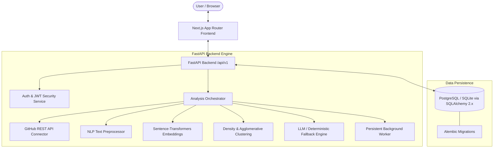
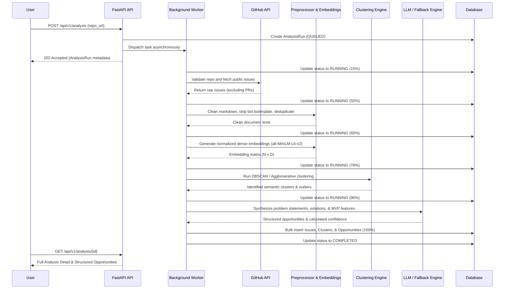

# InsightForge AI — System Architecture & Technical Specifications

**Tagline:** Turning Real User Problems into Product Opportunities.

---

## 1. Architectural Overview

InsightForge AI is an integrated, full-stack intelligence platform that discovers unmet user demand from public developer discussions (GitHub issues, bug reports, and feature requests) and synthesizes them into actionable, high-confidence SaaS product opportunities.

---

## 2. Core Modules & Responsibilities

### Frontend (`frontend/`)
- **Framework:** Next.js 16 (App Router) with React 19 and TypeScript.
- **Styling & UI:** Tailwind CSS, Lucide React, accessible contrast, responsive breakpoints (mobile, tablet, desktop).
- **Client Layer:** Centralized typed API client (`src/lib/api.ts`), persistent session context (`src/lib/auth-context.tsx`), and error boundary handling.
- **Key Views:**
  - `/`: Public landing page with live sample opportunity report and architecture explanation.
  - `/login` & `/register`: Secure authentication forms with real-time feedback.
  - `/dashboard`: High-level SaaS metrics and recent analysis run list.
  - `/dashboard/new`: Repository analysis submission form with preset exploration chips.
  - `/dashboard/analysis/[id]`: Real-time polling progress bar, problem clusters, and structured opportunity cards with traceable evidence modals.
  - `/dashboard/history`: Persisted search and filterable table of past analyses with delete actions.
  - `/dashboard/account`: Profile, session details, and security controls.

### Backend (`backend/app/`)
- **Framework:** FastAPI with Python 3.14 / 3.12 compatibility.
- **Validation:** Pydantic v2 schemas (`app/schemas/`).
- **ORM:** SQLAlchemy 2.0 with strict foreign key constraints, cascade deletes, and timezone-aware timestamps.
- **Database Migrations:** Alembic (`alembic/`) with versioned revision history.
- **Security:** Bcrypt salted password hashing and cryptographically signed JWT access tokens.
- **User Data Isolation:** Enforced at the repository level; users cannot view, poll, or modify analyses belonging to another user.

---

## 3. The AI & NLP Analysis Pipeline

### Deterministic Heuristic Fallback
When third-party LLMs (Ollama or hosted APIs) are offline or unconfigured:
1. The engine deterministically analyzes problem indicators (`fail`, `crash`, `broken`, `timeout`, `leak`, `missing`, `slow`).
2. Synthesizes pain statements, target customer segments, and 4 specific MVP requirements.
3. Calculates confidence score transparently:
   $$\text{Score} = 0.65 + \min(0.15, N \times 0.02) + \min(0.10, \text{Comments} \times 0.005) + 0.05$$
4. Clearly flags output as `is_fallback = true` with full explanation.

---

## 4. Database Schema

- `users`: ID, unique username, unique email, bcrypt hashed password, active flag, timestamps.
- `analysis_runs`: UUID primary key, `user_id` foreign key, repository metadata, status enum (`QUEUED`, `RUNNING`, `COMPLETED`, `FAILED`), progress percentage, current step, counts, `is_fallback` flag, error message.
- `collected_issues`: Issue number, title, body, cleaned text, GitHub URL, author, labels JSON, comment count, cluster reference.
- `analysis_clusters`: Cluster label, title, summary, size, recurring themes JSON, sample issue numbers.
- `product_opportunities`: Title, problem statement, business opportunity, proposed solution, customer segment, MVP features list JSON, market potential, confidence score, confidence explanation, supporting evidence quotes JSON, fallback flag.

