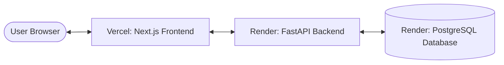

# Deployment Guide: InsightForge AI

This guide walks you through deploying **InsightForge AI** to production:
- **Backend API & Database:** Deployed on **[Render](https://render.com/)** (FastAPI + PostgreSQL)
- **Frontend Web App:** Deployed on **[Vercel](https://vercel.com/)** (Next.js App Router)

---

## Architecture Overview



---

## Step 1: Push Your Code to GitHub

Make sure all your code is committed and pushed to your GitHub repository:

```bash
git add .
git commit -m "feat: prepare production deployment configuration"
git push origin main
```

---

## Step 2: Deploy Backend & Database to Render

### Option A: 1-Click Render Blueprint (Recommended)

1. Log into your [Render Dashboard](https://dashboard.render.com/).
2. Click **New +** at the top right and select **Blueprint**.
3. Connect your GitHub repository.
4. Render will automatically detect [`render.yaml`](../render.yaml) and configure:
   - A free **PostgreSQL database** (`insightforge-db`).
   - A free **Web Service** (`insightforge-backend`).
   - Automatic migrations (`alembic upgrade head`) during build.
   - Auto-generated `SECRET_KEY` and environment variables.
5. Click **Apply**.
6. Wait 3–5 minutes for the build to finish. Once live, copy your backend service URL (e.g., `https://insightforge-backend.onrender.com`).

---

### Option B: Manual Setup on Render

If you prefer to configure services manually in Render:

#### 1. Create the PostgreSQL Database
1. Go to **New +** $\to$ **PostgreSQL**.
2. **Name:** `insightforge-db`
3. **Database:** `insightforge`
4. **Plan:** Free
5. Click **Create Database**.
6. Once provisioned, copy the **Internal Database URL** (or External URL).

#### 2. Create the Web Service (Backend)
1. Go to **New +** $\to$ **Web Service**.
2. Select your GitHub repository.
3. Configure the following fields:
   - **Name:** `insightforge-backend`
   - **Root Directory:** `backend` *(Important!)*
   - **Environment:** `Python 3`
   - **Build Command:** `./build.sh` *(or: `pip install -r requirements.txt && alembic upgrade head`)*
   - **Start Command:** `uvicorn app.main:app --host 0.0.0.0 --port $PORT`
   - **Plan:** Free
4. In the **Environment Variables** section, add:
   | Key | Value | Notes |
   | :--- | :--- | :--- |
   | `DATABASE_URL` | *Paste your Render PostgreSQL connection string* | If it starts with `postgres://`, our code automatically converts it to `postgresql://` |
   | `SECRET_KEY` | *A random 32+ character string* | Used for signing JWT session tokens |
   | `ENVIRONMENT` | `production` | Production mode |
   | `DEBUG` | `false` | Disables debug logs |
   | `CORS_ORIGINS` | `*` *(or your Vercel URL once known)* | Allows your frontend to communicate with the backend |
   | `USE_LIGHTWEIGHT_EMBEDDINGS` | `true` | **Crucial for Render Free Tier (512MB RAM)** to prevent out-of-memory errors |
   | `LLM_PROVIDER` | `deterministic_fallback` | Uses deterministic NLP synthesis, or set to `hosted` if you provide an API key |
   | `GITHUB_TOKEN` | *(Optional)* | Your personal GitHub token to unlock 5,000 requests/hour limit |
5. Click **Create Web Service**.
6. Once deployed, test your backend by visiting:
   `https://<your-backend-name>.onrender.com/api/v1/health`
   You should see `{"status":"ok", ...}`.

---

## Step 3: Deploy Frontend to Vercel

1. Log into your [Vercel Dashboard](https://vercel.com/).
2. Click **Add New...** $\to$ **Project**.
3. Import your GitHub repository (`InsightForge-AIV2`).
4. In the project configuration screen:
   - **Framework Preset:** `Next.js`
   - **Root Directory:** Click **Edit** and select **`frontend`** *(Crucial!)*
5. Expand the **Environment Variables** section and add:
   | Key | Value |
   | :--- | :--- |
   | `NEXT_PUBLIC_API_URL` | `https://<your-backend-name>.onrender.com/api/v1` |
   *(Replace `<your-backend-name>` with your actual Render URL from Step 2, ensuring `/api/v1` is at the end.)*
6. Click **Deploy**.
7. Vercel will build and deploy your app in about 1 minute, giving you a live URL like `https://insightforge-ai.vercel.app`.

---

## Step 4: Verification Checklist

1. **Visit your Vercel URL:** The landing page should load with full styling and the logo.
2. **Register a User:** Click **Get Started**, fill in your credentials, and verify you are redirected to `/dashboard`.
3. **Run an Analysis:** Click **New Analysis**, pick a preset (e.g. `fastapi/fastapi`), and click **Launch Analysis Pipeline**.
4. **Inspect Results:** Watch the real-time progress bar transition to **Completed**, then browse the generated Product Opportunities and Evidence modals!

---

## Important Production Notes

### 1. Render Free Tier Sleep & Cold Starts
On Render's Free tier, services spin down after 15 minutes of inactivity. When a request arrives, it may take 30–50 seconds to wake up. This is normal for free hosting. Upgrading to Render Starter ($7/mo) keeps it permanently active.

### 2. Memory Management (`USE_LIGHTWEIGHT_EMBEDDINGS=true`)
Render's free tier has a 512MB RAM cap. Loading full PyTorch models can trigger an Out-of-Memory (OOM) restart. Setting `USE_LIGHTWEIGHT_EMBEDDINGS=true` switches to our lightweight scikit-learn TF-IDF embedding engine, keeping memory usage under 100MB while preserving clustering and opportunity synthesis.

### 3. GitHub Rate Limits
Without a token, GitHub permits 60 requests/hour per IP. For high-volume analyses, generate a personal access token on GitHub (with public repo read permission) and add it to your Render environment variables as `GITHUB_TOKEN=ghp_...`.

